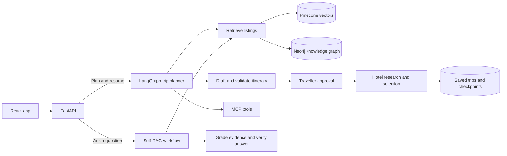

<p align="center"></p>

<h1 align="center">TravelBuddy</h1>

<p align="center">
  An Uttarakhand trip planner with sourced places, live planning progress, and a plan you can review before saving.
</p>

<p align="center">
  <a href="https://github.com/guniyal24/TravelBuddy/actions/workflows/ci.yml"></a>
</p>

<p align="center">
  <a href="https://travelbuddy-5md.pages.dev/">Live demo</a> ·
  <a href="#try-a-trip">Try a trip</a> ·
  <a href="#architecture">Architecture</a> ·
  <a href="#evaluation">Evaluation</a> ·
  <a href="#run-locally">Run locally</a> ·
  <a href="DEPLOY.md">Deploy</a>
</p>

TravelBuddy turns a request in English, Hindi, or Hinglish into a day-by-day trip through Garhwal or Kumaon. It retrieves hotels, restaurants, and activities from a regional knowledge base, checks the itinerary against travel rules, and shows price ranges with their assumptions. Travellers can try it as a guest, see which agents are working, and approve or edit the itinerary.

## Try a trip

Open the [live demo](https://travelbuddy-5md.pages.dev/) or the [local app](http://localhost:5173) after starting both services. Choose **Try it now, no sign-up** and paste:

> Three days in Haridwar and Rishikesh for two people in March. We prefer vegetarian food, a budget hotel, and a relaxed pace.

1. **Describe and choose.** Answer any follow-up questions, then pick a circuit. Season guidance appears before you commit to the route.
2. **Review the itinerary.** Open the agent trace, timeline, and map. Check the budget breakdown, transfer estimates, and advisory notes. Ask for a change or approve the plan.
3. **Choose a stay.** When alternatives are available, compare hotels by town. With Google Places configured, cards show ratings and attributed review excerpts. Your hotel selection updates the cost estimate.
4. **Save and use the plan.** Open **My trips**, tick booking tasks, and export a PDF, text summary, or `.ics` calendar. Booking links take you to the relevant external sites.
5. **Replan from a future day.** Pick a day and describe what changed. The itinerary and hotel selection keep completed days fixed.

The **Ask** tab runs a separate Q&A workflow. Try “Where can I do yoga in Rishikesh?” and open a source link to inspect its listing.

## What the app covers

| Feature | How it works |
|---|---|
| Regional knowledge base | The planner covers 26 towns. An ingestion pipeline collects Wikivoyage and OpenStreetMap listings, records provenance, and builds geographic relationships. |
| Itinerary validation | A deterministic Critic checks day order, listing IDs and types, town membership, duplicate stops, and overnight stays. Failed drafts are retried. A rule-based fallback goes through the same checks. |
| Routing, weather, and cost | Inter-town routing uses curated routes or a calibrated OSRM matrix. Dated trips can get forecasts or a labelled historical guide. Costs use ranges marked with their source or assumption. |
| Hotel concierge | LangGraph fans out research by town and gathers optional Tavily travel notes. A code score combines available ratings, review counts, tier, price, and review analysis. The verifier checks that each displayed pro or con cites an excerpt from its attributed review. |
| Traveller memory | LangGraph keeps the state of an in-progress trip. Approved trips can update preferences and past-trip memories, which travellers can view and delete. |
| Exports and offline access | The itinerary can be exported as text, PDF, or calendar events. The production PWA can reopen trips cached in the current session’s account context. |

## Architecture



- **Planner.** Intake collects trip dates, party size, interests, and constraints. The advisor suggests a circuit. Research retrieves candidates from Pinecone and looks up full Neo4j records. Stay, food, and transport specialists prepare the candidates before the LLM drafts an itinerary. The planner runs the Critic, season and altitude checks, weather lookup, and range-based pricing before asking for approval.
- **Human approval and live progress.** LangGraph interrupts pause the workflow for missing details, circuit choice, itinerary approval, and hotel selection. FastAPI streams step updates using Server-Sent Events. PostgreSQL or SQLite stores the checkpoint and approved trip.
- **Q&A.** The workflow retrieves and grades candidates, rewrites an unproductive query once, enriches the context with the graph, then drafts and checks the response. An unverified draft gets one retry before the workflow abstains. Source links come from the retrieved records.
- **Tooling.** A reusable MCP server exposes budget, season, altitude, weather, transport, conditions, review, and web-search tools. The application can use it in-process or via stdio. [MCP setup](mcp_server/README.md)

## Evaluation

The figures below come from the dated benchmark reports in the repository. The Q&A suite has **104 questions**, including 79 answerable and 25 unanswerable questions in English, Hindi, and Hinglish. [Full Q&A report and confidence intervals](eval/RESULTS.md)

| System | Retrieval hit rate | Answers naming places outside the data | Answers answerable questions | Declines unanswerable questions |
|---|---:|---:|---:|---:|
| LLM only | — | 73% | 100% | 16% |
| Plain RAG | 87% | 0% | 59% | 100% |
| Self-RAG | 96% | 1% | 97% | 100% |

- **Planner validation.** All 30 scenarios reached review and passed the applicable plan checks. The first draft passed the Critic in 90% of scenarios. Disabling the Critic let two errors through, an unknown place and a meal in the wrong town. [Plan report](eval/PLANS.md) · [Ablations](eval/ABLATIONS.md)
- **Time and cost.** Median time to itinerary review was **17 seconds**, and median estimated LLM fees were **₹0.01**. These measurements cover the planner up to review. Optional hotel research and external provider charges have separate costs. [Plan report](eval/PLANS.md)
- **Judge reliability.** A checklist jury uses three model families, repeated votes, and cached verdicts. On 30 answers judged five times, headline verdicts changed on 0–3% of answers. The report describes where the rubric was less stable. [Judge reliability](eval/RELIABILITY.md)
- **Concierge and safeguards.** In the recorded hotel benchmark, 92% of proposed claims passed the quote check. The recorded adversarial suite reports its outcomes separately. [Hotel research](eval/CONCIERGE.md) · [Adversarial evaluation](eval/REDTEAM.md)

GitHub Actions runs Python tests with PostgreSQL, frontend builds, a Docker build, and live evaluation gates when the required provider secrets are available. [Evaluation commands](eval/README.md) · [CI workflow](.github/workflows/ci.yml)

## Run locally

Use Python 3.11 or newer and Node.js. For live planning, have a Neo4j database, a Pinecone index, and a DeepInfra key or compatible model provider. AuraDB Free can host the project’s travel graph. An idle Free instance may need to be resumed in the Aura console. If Neo4j is unavailable at startup, the API uses a bundled snapshot for guest planning and Q&A. Account sign-in requires the live graph.

### Set up the backend

```bash
python3 -m venv .venv
source .venv/bin/activate
pip install -r requirements-dev.txt
test -f .env || cp .env.example .env
```

| Set in `.env` | Purpose |
|---|---|
| `SECRET_KEY` | Private key used to sign account and guest tokens. |
| `NEO4J_URI`, `NEO4J_USER`, `NEO4J_PASSWORD` | URI and database credentials for the same Neo4j instance. Use `NEO4J_DATABASE=neo4j` for the default Aura database. |
| `PINECONE_API_KEY`, `PINECONE_INDEX_NAME` | Vector search credentials and index. The default embedding model uses 1,024 dimensions. |
| `DEEPINFRA_API_KEY` | Model and embedding calls with the default provider configuration. |
| `DATABASE_URL` | Optional PostgreSQL URL for trips, profiles, checkpoints, and memory. Local development defaults to SQLite. |
| `GOOGLE_PLACES_API_KEY`, `TAVILY_API_KEY` | Optional hotel reviews and current travel notes. Review lookups can incur provider charges. |

### Load the knowledge base

Reuse `data/processed/entities.json` if you already have the generated dataset. A fresh checkout can build it with `python -m ingest.build`.

```bash
python -m ingest.load neo4j --dry-run
python -m ingest.load neo4j
python -m ingest.load pinecone
```

If you are replacing only Neo4j and Pinecone already contains embeddings for the same dataset, run the Neo4j commands and keep the existing index. The loader upserts the travel graph. On a fresh instance, account records from another Neo4j database require a backup restore. [Deployment and recovery](DEPLOY.md)

### Start both services

```bash
# Terminal 1, from the repository root
.venv/bin/python -m uvicorn app.api.asgi:app --reload --port 8000
```

```bash
# Terminal 2, from the repository root
cd frontend
npm ci
npm run dev
```

- [Website](http://localhost:5173) · [API documentation](http://localhost:8000/docs)
- `GET /health` checks whether the API is running. `GET /health/deps` probes the configured graph, vector index, models, trip storage, and weather service.

### Run checks

```bash
.venv/bin/python -m pytest -q
.venv/bin/ruff check .
npm --prefix frontend run build
```

Set `TEST_DATABASE_URL` to a dedicated UTF-8 test database to include PostgreSQL storage and restart tests. The live evaluation commands use the configured model and retrieval providers. [Evaluation instructions](eval/README.md)

## Repository map

| Path | What to look for |
|---|---|
| [`frontend/`](frontend/) | React interface, Leaflet, planner trace, saved trips, and PWA assets |
| [`app/api/`](app/api/) | FastAPI, guest sessions, rate limits, ownership checks, and streaming |
| [`app/graph/`](app/graph/) | LangGraph workflow, specialists, Critic, hotel research, and timelines |
| [`app/rag/`](app/rag/) | Vector search, graph enrichment, and Self-RAG |
| [`app/rules/`](app/rules/) and [`app/cost/`](app/cost/) | Deterministic altitude, season, advisory, and budget rules |
| [`ingest/`](ingest/) | Source collection, geocoding, provenance, graph and vector loaders |
| [`mcp_server/`](mcp_server/) | Travel tools and MCP transports |
| [`eval/`](eval/) and [`tests/`](tests/) | Benchmarks, quality gates, and automated regressions |

[Portfolio notes and walkthrough](docs/PORTFOLIO.md) · [Engineering write-up](docs/blog-draft.md) · [Deployment guide](DEPLOY.md)

## Data and attribution

Listings draw on Wikivoyage (CC BY-SA 4.0) and OpenStreetMap contributors (ODbL). Weather uses Open-Meteo with a MET Norway fallback. The source pipeline stores attribution, and the landing page includes credits for its town photography.

TravelBuddy is a planning aid. Confirm departure times, fares, opening hours, permits, and current travel advisories with the relevant operators.
