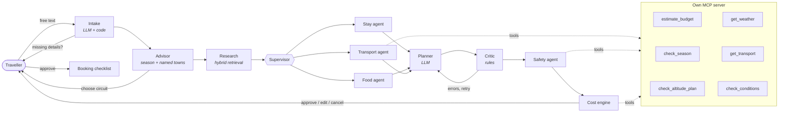

<p align="center"></p>

<h3 align="center">An AI trip planner for Uttarakhand that shows its work</h3>

<p align="center">
  <b>Live demo:</b> <i>coming soon</i> · try it as a guest, no sign-up ·
  <a href="#evaluation">Evaluation</a> · <a href="#architecture">Architecture</a> · <a href="DEPLOY.md">Deploy</a>
</p>


---

Describe a trip in plain English, Hindi or Hinglish (*"Nainital aur Almora, 4 din, vegetarian
khana, 2 log, December"*). TravelBuddy proposes circuits that fit the season, builds a
day-by-day plan from **real listings only**, checks it with rule-based agents, prices it as an
honest range, and **waits for your approval** before anything is final. You can watch every
agent work, live.

## The problem

Generic chatbots plan hill trips confidently and wrongly. In this project's own evaluation, an
LLM without retrieval **named places that are not in the data in 85% of answers** and invented
prices or timings for every question it could not answer. In the mountains that costs real money
and can be unsafe (altitude, monsoon roads, Char Dham registration).

TravelBuddy's rule: **the LLM composes, code checks, the human decides.**

## What it does

| | |
|---|---|
| **Plans from a knowledge graph** | 333 sourced listings (Wikivoyage, OpenStreetMap) in Neo4j + Pinecone. The planner may only use ids it was given; a Critic rejects anything else. |
| **Human in the loop** | Pick a circuit, approve or ask for changes ("less walking", "add a yoga class"), re-plan mid-trip from any day. Paused plans survive server restarts. |
| **Live agent trace** | Each agent's real work streams to the UI (Server-Sent Events): what it found, what the Critic rejected, timings. |
| **Safety agent** | Altitude-gain rules, high-altitude health notes, monthly advisories with official links to confirm. |
| **Honest costs** | Ranges, never single numbers; every line says if it is a listing price or an assumption. |
| **Grounded Q&A** | Self-RAG answers with citations, and declines instead of guessing. |
| **Hindi / Hinglish** | Requests, plans and answers follow the traveller's language. |
| **Try without an account** | One-click guest mode with per-IP and daily cost caps. |
| **Export & offline** | WhatsApp text, PDF, calendar (.ics), booking checklist; opened trips work offline (PWA). |

## Architecture



- **LangGraph** state machine with `interrupt()` for human decisions and a durable checkpointer
  (Postgres in production, SQLite locally).
- **Multi-agent:** Stay, Food and Transport agents run in parallel; the Critic, Safety agent
  and cost engine are deterministic code, so their output is testable.
- **MCP:** the planner reaches its tools through a real MCP client, in-process or over stdio.
  The same server works in any MCP host: `python -m mcp_server.server`.
- **Self-RAG** for Q&A: retrieve → grade → rewrite → answer → verify grounding → or decline.
- **Hybrid retrieval:** Pinecone vectors (bge-m3) + Neo4j graph context.

## Evaluation

25-question golden set (20 answerable, 5 deliberately unanswerable), three systems, same judge:

| System | Retrieval hit@k | Names places not in data ↓ | Answers the question | Declines when it should | Invents specifics ↓ | Latency |
|---|---|---|---|---|---|---|
| LLM only | n/a | **85%** | 100% | 0% | **100%** | 27.5 s |
| Plain RAG | 95% | 0% | 55% | 100% | 0% | 5.3 s |
| **Self-RAG** | **96%** | 4% | **100%** | **100%** | **0%** | 7.2 s |

Self-RAG keeps the grounding of plain RAG while answering every answerable question.
**CI quality gate:** `eval/gate.py` fails the build if these regress. Full results:
[`eval/RESULTS.md`](eval/RESULTS.md).

*Known limitation, being worked on:* the judge is a single LLM call. The next step is a
checklist-based jury with measured agreement against human labels (Cohen's kappa) and run-to-run
stability.

## Engineering

- **171 tests** (pytest), ruff, CI on every push, storage tests against real Postgres in CI.
- Guardrails: per-user and guest rate limits (Redis, in-memory fallback), JWT auth, CORS,
  guest sessions capped per IP and per day.
- Graceful degradation: tool failures become "unknown", never invented values; a rule-based
  fallback plan if the LLM cannot produce a valid one in 3 attempts.
- Data pipeline (`ingest/`) with provenance and confidence on every fact, and licence-aware
  handling of Google-sourced data.

## Tech stack

LangGraph · MCP · Self-RAG · Neo4j · Pinecone · DeepInfra (Mistral Small, Llama 3.3 70B judge,
bge-m3 embeddings) · FastAPI · Postgres · Redis · React + Vite · Leaflet · GitHub Actions ·
Docker · Render · Vercel

## Run locally

```bash
python3 -m venv .venv && source .venv/bin/activate
pip install -r requirements-dev.txt
cp .env.example .env            # add your keys
pytest -q
uvicorn app.api.asgi:app --reload --port 8000

cd frontend && npm install && npm run dev   # http://localhost:5173
```

Optional: `TEST_DATABASE_URL=postgresql://...` runs the storage tests against Postgres too.
To rebuild the knowledge base: `python -m ingest.build`, then `python -m ingest.load neo4j` and
`python -m ingest.load pinecone`. Deploying: see [DEPLOY.md](DEPLOY.md).

## Layout

```
app/api      FastAPI routes, auth, guest mode, rate limits, SSE streaming
app/graph    LangGraph trip planner, agents, Critic, live trace
app/rag      Self-RAG and hybrid retrieval
app/rules    Season, altitude and advisory checks
app/cost     Deterministic cost engine
app/trips    Saved trips and profiles (SQLite or Postgres)
mcp_server/  Own MCP server and client
ingest/      Data pipeline: Wikivoyage, OpenStreetMap, Open-Meteo
eval/        Golden set, metrics, CI gate
frontend/    React app (PWA)
```

## Roadmap

1. Reliable LLM-as-judge: checklists, a multi-model jury, human-label agreement.
2. Concierge stage: after approval, parallel agents research hotels (reviews) and live travel
   info, with every claim cited and verified.
3. Agent memory across trips, user-visible and deletable.
4. Real travel dates with live weather, more towns, road routing.

## Data and licences

Wikivoyage (CC BY-SA 4.0), OpenStreetMap contributors (ODbL), Open-Meteo. Generated data in
`data/processed/` is git-ignored. Google-sourced coordinates are never committed or published.
A planning aid only: check weather, road and permit advisories before you travel.
