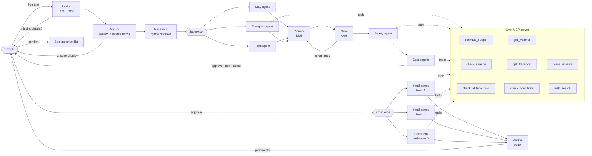

<p align="center"></p>

<h3 align="center">An AI trip planner for Uttarakhand that shows its work</h3>

<p align="center">
  <b>Live demo:</b> <i>coming soon</i> · try it as a guest, no sign-up ·
  <a href="#evaluation">Evaluation</a> · <a href="#architecture">Architecture</a> · <a href="DEPLOY.md">Deploy</a>
</p>


---

Describe a trip in plain English, Hindi or Hinglish (*"Nainital aur Almora, 4 din, vegetarian
khana, 2 log, December"*). TravelBuddy proposes circuits that fit the season, builds a
day-by-day plan from **real listings only**, checks it with rule-based agents, prices it as an
honest range, and **waits for your approval** before anything is final. You can watch every
agent work, live.

## The problem

Generic chatbots plan hill trips confidently and wrongly. In this project's own evaluation, an
LLM without retrieval **named places that are not in the data in 85% of answers** and invented
prices or timings for every question it could not answer. In the mountains that costs real money
and can be unsafe (altitude, monsoon roads, Char Dham registration).

TravelBuddy's rule: **the LLM composes, code checks, the human decides.**

## What it does

| | |
|---|---|
| **Plans from a knowledge graph** | 721 sourced places in 26 towns (Wikivoyage and OpenStreetMap) in Neo4j + Pinecone. The planner may only use ids it was given; a Critic rejects anything else. |
| **Human in the loop** | Pick a circuit, approve or ask for changes ("less walking", "add a yoga class"), re-plan mid-trip from any day. Paused plans survive server restarts. |
| **Live agent trace** | Each agent's real work streams to the UI (Server-Sent Events): what it found, what the Critic rejected, timings. |
| **Concierge** | After you approve, hotel agents run in parallel, one per overnight town. They read Google reviews of that town's hotels, an analyst extracts pros and cons **with exact quotes** (checked in code; 95% survive), a code ranker orders them, and you pick. The plan and cost update. |
| **Agent memory** | After you approve a trip, a memory agent keeps the lasting preferences you stated ("avoid long drives"), each with your **exact words** (checked in code), plus a short episode of the trip. Next time they shape the plan and towns you visited are labelled. You can see and delete every memory. Contact, ID and payment details are never stored. |
| **Safety agent** | Altitude-gain rules, high-altitude health notes, monthly advisories with official links to confirm. |
| **Honest costs** | Ranges, never single numbers; every line says if it is a listing price or an assumption. |
| **Grounded Q&A** | Self-RAG answers with citations, and declines instead of guessing. |
| **Dates, weather and roads** | Say "from next Friday" and the plan gets real dates. A weather agent checks every day's town (live forecast within 16 days, otherwise a labelled typical estimate) and flags heavy rain with a re-plan suggestion. Road times come from OpenStreetMap routing, calibrated against hand-checked routes (distances within 4%). |
| **Hindi / Hinglish** | Requests, plans and answers follow the traveller's language. |
| **Try without an account** | One-click guest mode with per-IP and daily cost caps. |
| **Export & offline** | WhatsApp text, PDF, calendar (.ics), booking checklist; opened trips work offline (PWA). |

## Architecture



- **LangGraph** state machine with `interrupt()` for human decisions and a durable checkpointer
  (Postgres in production, SQLite locally): short-term memory for a trip in progress.
- **Long-term memory** on LangGraph's `BaseStore` (`PostgresStore` / `SqliteStore`), namespaced
  per traveller: semantic memories (preferences) and episodic memories (past trips), learned
  only from approved trips, recalled at intake.
- **Multi-agent:** Stay, Food and Transport agents run in parallel; the Critic, Safety agent
  and cost engine are deterministic code, so their output is testable. After approval the
  Concierge fans out with LangGraph `Send`: one hotel agent per overnight town plus a
  travel-info agent, all concurrently.
- **Untrusted content:** reviews and web pages reach the LLM only inside a delimited block
  marked as data, the LLM can only fill a fixed JSON shape, every quote is verified against its
  source in code, and ranking never depends on LLM text.
- **MCP:** the planner reaches its tools through a real MCP client, in-process or over stdio.
  The same server works in any MCP host: `python -m mcp_server.server`.
- **Self-RAG** for Q&A: retrieve → grade → rewrite → answer → verify grounding → or decline.
- **Hybrid retrieval:** Pinecone vectors (bge-m3) + Neo4j graph context.

## Evaluation

Three reports, all regenerated by commands in [`eval/`](eval/README.md), plus a CI gate.

**1. Answers: do they come from our data, and decline when it isn't there?** 104 questions (79
answerable, 25 not: towns outside the data, live facts, false premises, prompt injection), in
English, Hindi and Hinglish. Rates with 95% intervals; full table in
[`eval/RESULTS.md`](eval/RESULTS.md).

| System | Retrieval hit@k | Names places not in our data ↓ | Answers the question | Declines when it can't know | Invents specifics ↓ |
|---|---|---|---|---|---|
| LLM only | n/a | **73%** | 100% | 16% | **80%** |
| Plain RAG | 87% | 0% | 59% | 100% | 0% |
| **Self-RAG** | **96%** | **1%** | **97%** | **100%** | **0%** |

A plain LLM answers everything and makes up most of it. Plain RAG is safe but answers only
59% of what it could. Self-RAG keeps the safety and answers 97%, including in Hindi.

**2. Plans: are they valid for what was asked?** 30 trip requests through the real planner,
every check computed in code ([`eval/PLANS.md`](eval/PLANS.md)): 100% reach approval with the
exact day count, every named town, meals and stops in the right town, a stay every night, veg
respected, budgets flagged, health notes above 2,500 m, and no rule-based fallback. The LLM's
first draft passes the Critic 90% of the time; the Critic catches the rest.

**3. Can the judge be trusted?** ([`eval/RELIABILITY.md`](eval/RELIABILITY.md)) The judge is a
jury of three model families (Llama, Qwen, Gemma) answering yes/no checklists, with named
places verified in code and verdicts cached for exact reproducibility. Re-judging 30 answers 5
times: headline verdicts flip on 0-3% of answers. One checklist item (`on_topic`) flips on 23%,
all on polite declines, a rubric ambiguity that is next to fix. Agreement with human labels
(Cohen's kappa) is measured with `python -m eval.reliability label` and `agreement`.

**CI gate:** `eval/gate.py` fails the build if answer or plan quality regresses, or if any
judgement is incomplete.

## Engineering

- **240 tests** (pytest), ruff, CI on every push, storage tests against real Postgres in CI.
- Guardrails: per-user and guest rate limits (Redis, in-memory fallback), JWT auth, CORS,
  guest sessions capped per IP and per day.
- Graceful degradation: tool failures become "unknown", never invented values; a rule-based
  fallback plan if the LLM cannot produce a valid one in 3 attempts.
- Data pipeline (`ingest/`) with provenance and confidence on every fact, and licence-aware
  handling of Google-sourced data.

## Tech stack

LangGraph · MCP · Self-RAG · Neo4j · Pinecone · DeepInfra (Mistral Small, Llama 3.3 70B judge,
bge-m3 embeddings) · FastAPI · Postgres · Redis · React + Vite · Leaflet · GitHub Actions ·
Docker · Render · Vercel

## Run locally

```bash
python3 -m venv .venv && source .venv/bin/activate
pip install -r requirements-dev.txt
cp .env.example .env            # add your keys
pytest -q
uvicorn app.api.asgi:app --reload --port 8000

cd frontend && npm install && npm run dev   # http://localhost:5173
```

Optional: `TEST_DATABASE_URL=postgresql://...` runs the storage tests against Postgres too.
To rebuild the knowledge base: `python -m ingest.build`, then `python -m ingest.load neo4j` and
`python -m ingest.load pinecone`. Deploying: see [DEPLOY.md](DEPLOY.md).

## Layout

```
app/api      FastAPI routes, auth, guest mode, rate limits, SSE streaming
app/graph    LangGraph trip planner, agents, Critic, live trace
app/rag      Self-RAG and hybrid retrieval
app/rules    Season, altitude and advisory checks
app/cost     Deterministic cost engine
app/trips    Saved trips and profiles (SQLite or Postgres)
mcp_server/  Own MCP server and client
ingest/      Data pipeline: Wikivoyage, OpenStreetMap, Open-Meteo
eval/        Golden set, metrics, CI gate
frontend/    React app (PWA)
```

## Roadmap

1. Reliable LLM-as-judge: checklists, a multi-model jury, human-label agreement.
2. Tighten the judge's `on_topic` rubric for polite declines; collect human labels for kappa.

## Data and licences

Wikivoyage (CC BY-SA 4.0), OpenStreetMap contributors (ODbL), Open-Meteo. Generated data in
`data/processed/` is git-ignored. Google-sourced coordinates are never committed or published.
A planning aid only: check weather, road and permit advisories before you travel.
